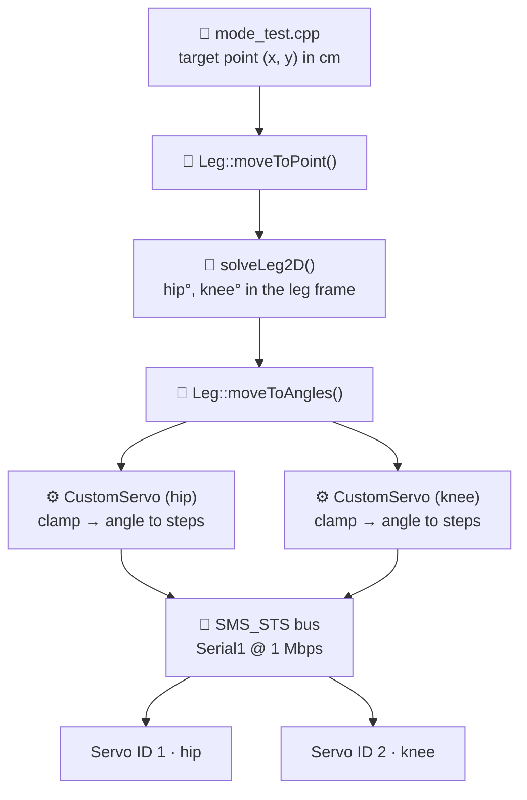

<div align="center">

# 🦿 RobotLegV2

**A two-joint robot leg driven by serial bus servos and 2D inverse kinematics on an ESP32.**

Tell the leg *where* to put its foot, and it works out *how* to bend.


</div>

---

## 📑 Contents

- [What it does](#-what-it-does)
- [Hardware](#-hardware)
- [Project structure](#-project-structure)
- [How the code is layered](#-how-the-code-is-layered)
- [The math: inverse kinematics](#-the-math-inverse-kinematics)
- [Calibration: offsets and directions](#-calibration-offsets-and-directions)
- [Getting started](#-getting-started)
- [Run modes](#-run-modes)
- [Worked example](#-worked-example)
- [API reference](#-api-reference)
- [Roadmap](#-roadmap)

---

## ✨ What it does

RobotLegV2 controls a planar leg with two joints, a **hip** and a **knee**, each driven by a 12-bit serial bus servo.

- 🎯 **Point control.** Command a foot position `(x, y)` in centimeters; the leg solves for the joint angles.
- 📐 **Analytic IK.** Closed-form law-of-cosines solution, no iteration.
- 🛡️ **Reachability guard.** Points the leg can't physically reach are rejected instead of attempted.
- 🔧 **Per-joint calibration.** Each servo has its own zero offset, direction, home pose, and safe angle range.
- 🔀 **Run modes.** Switch between the main program and a test routine with a single build flag.

---

## 🔌 Hardware

| Component | Details |
|---|---|
| Microcontroller | ESP32 |
| Actuators | 2 × STS-series serial bus servos (4096 steps per revolution) |
| Servo bus | `Serial1` at **1 Mbps**, 8N1 |
| Thigh (L1) | **10.5 cm**, hip axis to knee axis |
| Shin (L2) | **4.5 cm**, knee axis to foot |

### Wiring

| Signal | ESP32 pin | Defined in |
|---|---|---|
| Servo bus RX (ESP32 receives) | `GPIO 16` | `S_RXD` in `mode_test.cpp` |
| Servo bus TX (ESP32 transmits) | `GPIO 17` | `S_TXD` in `mode_test.cpp` |
| Debug output | USB serial, 115200 baud | `Serial` |

### Servo IDs

| Joint | Servo ID |
|---|---|
| Hip | `1` |
| Knee | `2` |

> [!NOTE]
> If your servo driver board routes the bus to different pins, change `S_RXD` and `S_TXD` to match. If the pins are wrong, the code runs normally but the servos never respond.

---

## 🗂️ Project structure

```
RobotLegV2/
├── main.cpp            # Entry point: picks setup/loop based on RUN_MODE
├── mode_main.h/.cpp    # RUN_MODE 1: main program (placeholder)
├── mode_test.h/.cpp    # RUN_MODE 2: hardware config + test routine
├── leg.h/.cpp          # Leg: pairs two servos with link lengths
├── kinematics.h/.cpp   # solveLeg2D(): pure inverse kinematics math
└── customServo.h/.cpp  # CustomServo: angles ↔ steps, limits, calibration
```

---

## 🧱 How the code is layered

Each layer works in **one unit** and only hands the next layer what it needs.



| Layer | File | Speaks in | Knows about |
|---|---|---|---|
| Run mode | `mode_test.cpp` | centimeters | What the leg should do |
| Leg | `leg.cpp` | centimeters → degrees | Link lengths, which servo is which joint |
| Kinematics | `kinematics.cpp` | degrees | Geometry only; no hardware at all |
| Servo | `customServo.cpp` | degrees → steps | Zero offset, direction, limits |
| Bus | `SCServo` library | steps → bytes | The serial protocol |

Because only `CustomServo` knows about steps, offsets, and directions, you can recalibrate a joint without touching any of the math.

---

## 📐 The math: inverse kinematics

The leg lives in a 2D frame with the **hip axis at the origin**:

```
        +Y
         ▲
         │      • target (x, y)
         │     ╱
         │ L2 ╱  ← shin
         │   ●  knee
         │  ╱
         │ ╱ L1  ← thigh
         │╱ θhip
   hip ● ┼──────────────► +X
```

- **Hip angle** is measured from the **+X axis**, counterclockwise positive.
- **Knee angle** is the bend **relative to the thigh**: `0°` means fully straight.

### Step 1: distance to the target

$$r = \sqrt{x^2 + y^2}$$

### Step 2: can the leg reach it?

$$|L_1 - L_2| \le r \le L_1 + L_2 \quad\Rightarrow\quad 6\text{ cm} \le r \le 15\text{ cm}$$

Anything outside this ring returns `false`, and the leg doesn't move.

### Step 3: knee angle (law of cosines)

$$\theta_{knee} = \arccos\left(\frac{r^2 - L_1^2 - L_2^2}{2\,L_1\,L_2}\right)$$

### Step 4: hip angle

Aim straight at the target, then back off by the angle the thigh leads the bend:

$$\theta_{hip} = \operatorname{atan2}(y,\,x) - \arccos\left(\frac{r^2 + L_1^2 - L_2^2}{2\,L_1\,r}\right)$$

Both cosine arguments are clamped to `[-1, 1]` before `acos` to absorb floating-point rounding.

---

## 🔧 Calibration: offsets and directions

The IK's "0°" and a servo's "step 0" are **two different reference frames**. Two constructor parameters connect them:

$$\text{steps} = \text{zeroOffset} + \text{dir} \times \theta \times \frac{4096}{360}$$

| Parameter | Meaning |
|---|---|
| `zeroOffset` | The raw step where the joint sits at IK **0°** |
| `dir` | `+1` if the servo turns the same way as the math, `-1` if opposite |

### Current calibration

| Joint | ID | Min | Max | Home | `zeroOffset` | `dir` | Step range used |
|---|---|---|---|---|---|---|---|
| Hip | 1 | 0° | 180° | 90° | `1024` | `+1` | 1024 – 3072 |
| Knee | 2 | -90° | 90° | 0° | `2048` | `+1` | 1024 – 3072 |

### How to calibrate a joint

1. **Disable torque** on the joint so you can move it by hand.
2. **Pose it at IK 0°.** The hip points along +X; the knee is fully straight.
3. **Read the raw position** with `bus.ReadPos(id)`. That number is your `zeroOffset`.
4. **Check the direction.** Command a small positive angle. If the joint turns clockwise when the math expects counterclockwise, set `dir = -1`.
5. **Check the range.** Run `minAngle` and `maxAngle` through the formula above. Both must land inside **0 – 4095**.

> [!TIP]
> **Lesson learned in V2:** if the leg reaches the right shapes but **X and Y are swapped** while both stay positive, that's a *mirror* across the diagonal, not just a rotation. Fixing it takes **both** knobs: shift `zeroOffset` by 90° (1024 steps) **and** flip `dir`.
>
> When every layer checks out on its own but the result is wrong, look at the assumptions *between* the layers.

---

## 🚀 Getting started

1. **Clone the repository**
   ```bash
   git clone https://github.com/Uzarrees/RobotLegV2.git
   ```
2. **Install the servo library.** The project depends on the Feetech **`SCServo`** library (`SMS_STS` class).
3. **Pick a run mode** (see below). For a first hardware check, use `RUN_MODE 2`.
4. **Wire and power** the servos, then connect the ESP32 over USB.
5. **Upload** the firmware and open the serial monitor at **115200 baud**.

---

## 🔀 Run modes

`main.cpp` selects which `setup()` and `loop()` to run at compile time. If no mode is set, it defaults to `1`.

| Mode | Files | What it does |
|---|---|---|
| `1` | `mode_main.cpp` | Main program (currently an empty placeholder) |
| `2` | `mode_test.cpp` | Enables torque, homes the leg, then cycles through four test points |

Any other value stops the build with `#error "Unknown RUN_MODE"`.

Set the mode with a compiler flag, for example in PlatformIO:

```ini
build_flags = -D RUN_MODE=2
```

or by editing the default directly in `main.cpp`:

```cpp
#define RUN_MODE 2
```

---

## 🧪 Worked example

The test routine (`RUN_MODE 2`) visits four points, pausing 2 seconds at each. With the current calibration:

| Point | Target (cm) | r (cm) | Hip | Knee | Hip steps | Knee steps | Pose |
|---|---|---|---|---|---|---|---|
| **A** | (0, 15) | 15.0 | 90.0° | 0.0° | ≈ 2048 | 2048 | Straight up, fully extended |
| **B** | (4.5, 10.5) | 11.4 | 43.6° | 90.0° | ≈ 1520 | ≈ 3072 | Knee bent at a right angle |
| **C** | (10.5, 4.5) | 11.4 | 0.0° | 90.0° | ≈ 1024 | ≈ 3072 | Thigh along +X, shin pointing up |
| **D** | (15, 0) | 15.0 | 0.0° | 0.0° | ≈ 1024 | 2048 | Straight along +X, fully extended |

Example serial output:

```
Torque enabled
Homed

Reaching point A (0, 15)
Hip angle: 90.00	Knee angle: 0.00

Reaching point B (4.5, 10.5)
Hip angle: 43.60	Knee angle: 90.00
```

> [!WARNING]
> Points **A** and **D** sit exactly at full extension (r = L1 + L2). That's a kinematic singularity: tiny rounding errors can flip them to "unreachable." For robust tests, stay slightly inside, such as `r = 14.9`.

---

## 📚 API reference

### `Leg`

| Method | Description |
|---|---|
| `Leg(hip, knee, L1, L2)` | Pairs two servos with the thigh and shin lengths |
| `enable()` / `disable()` | Torque on/off for both joints |
| `home()` | Sends both joints to their home angles |
| `moveToAngles(hipDeg, kneeDeg)` | Commands joint angles directly |
| `moveToPoint(x, y)` | Solves IK and moves the foot; returns `false` if unreachable |

### `CustomServo`

| Method | Description |
|---|---|
| `CustomServo(id, minAngle, maxAngle, home, zeroOffset, dir = 1)` | Defines a joint and its calibration |
| `attach(bus)` | Connects the shared `SMS_STS` bus (call once in `setup`) |
| `enable()` / `disable()` | Torque on/off |
| `moveTo(angle)` | Moves to an absolute angle, clamped to the safe range |
| `moveFraction(f)` | `0.0` = `minAngle`, `1.0` = `maxAngle` |
| `home()` | Moves to the home angle |
| `readAngle()` | Reads the current position as an angle |
| `inRange(angle)` | `true` if the angle is within the joint limits |
| `id()` | Returns the servo ID |

### `solveLeg2D`

```cpp
bool solveLeg2D(float x, float y, float L1, float L2,
                float& hipAngle, float& kneeAngle);
```

Pure math, with no hardware dependency. Writes the hip and knee angles in degrees and returns `true`, or returns `false` and leaves the outputs untouched if the point is out of reach.

---

## 🗺️ Roadmap

- [ ] **Reject joint-limit violations.** `moveToPoint()` should check `inRange()` on both angles instead of letting `moveTo()` clamp silently.
- [ ] **Synchronized moves.** Replace the two separate `WritePosEx` calls with `SyncWritePosEx` so both joints start together and arrive together.
- [ ] **Safer read-back.** `readAngle()` should detect a failed `ReadPos` (it returns `-1`) instead of converting it to an angle.
- [ ] **Shared hardware config.** Move the bus, pins, and servo definitions out of `mode_test.cpp` into a common file every mode can use.
- [ ] **Main program.** Fill in `RUN_MODE 1`.
- [ ] **Trajectories.** Interpolate between points so the foot follows straight lines.

---

<div align="center">

Built by **[Uzarrees](https://github.com/Uzarrees)** · Part of an ongoing robotics project 🤖

</div>
